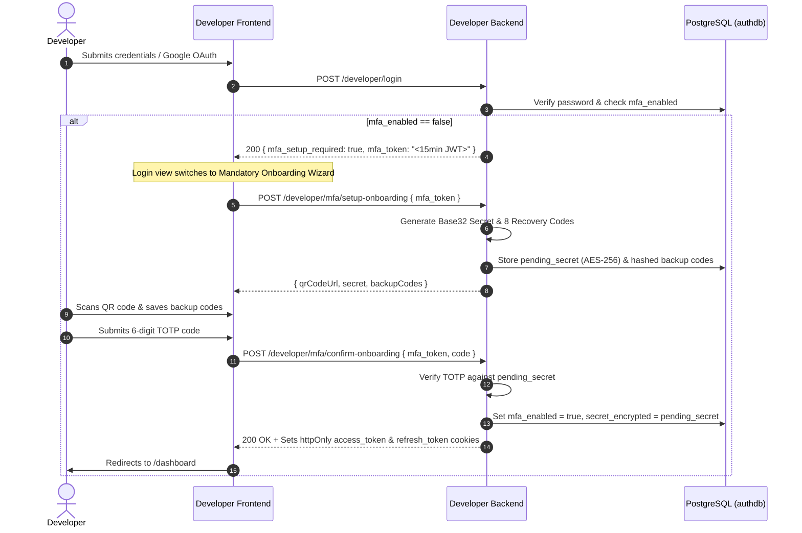
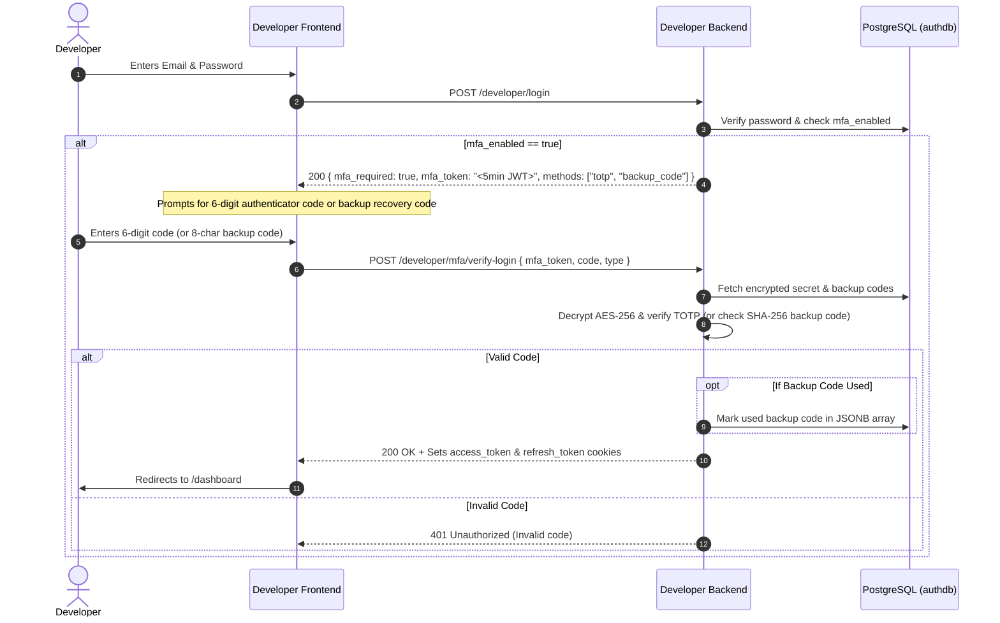
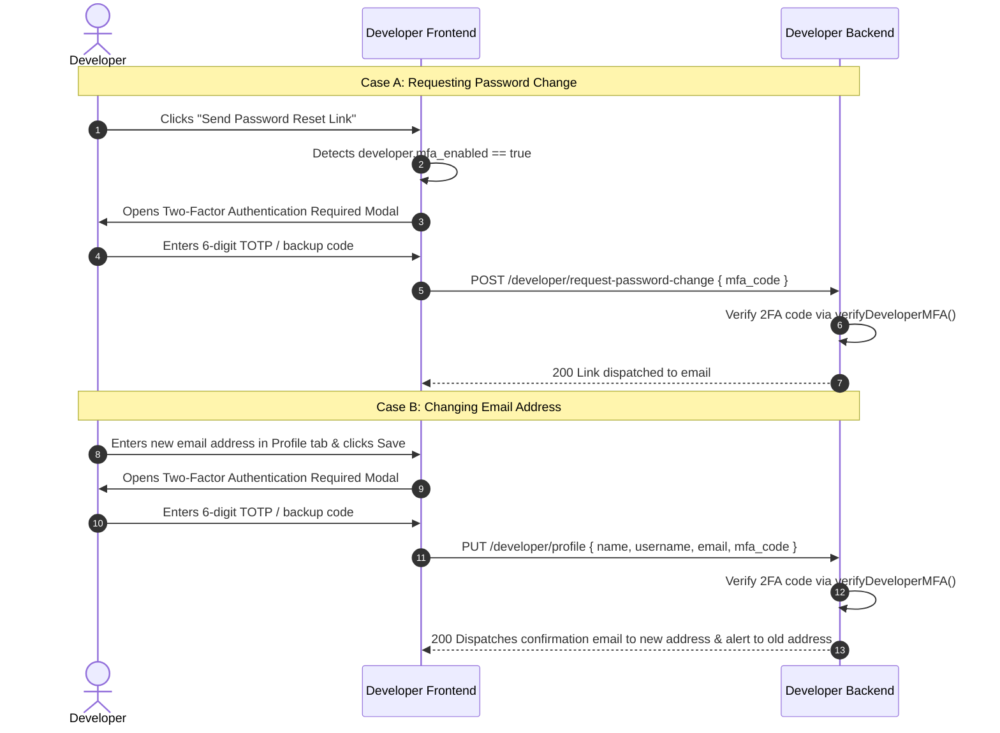

# Developer Portal Multi-Factor Authentication (MFA / 2FA) Documentation

This document explains the technical architecture, cryptographic algorithms, workflows, database schema, and tools/packages used to implement **Two-Factor Authentication (2FA)** for developer accounts in the Auth Server Developer Portal.

---

## 1. Overview & Security Architecture

The Two-Factor Authentication (2FA) system adds a second layer of defense beyond passwords. Even if an attacker compromises a developer's password, access remains blocked without the physical device generating the time-synchronized code.

### Core Security Guarantees:
1. **RFC 6238 TOTP Standard**: Compatible with all major authenticator apps (Google Authenticator, Microsoft Authenticator, Authy, Apple Passwords, 1Password, Bitwarden).
2. **Zero Plaintext Secrets**: TOTP secrets are encrypted with **AES-256-CBC** before being written to PostgreSQL (`dev_mfa_settings.secret_encrypted`).
3. **Mandatory Enforcement**: All developer accounts are required to configure 2FA upon registration or initial sign-in. Disabling 2FA is prohibited.
4. **Single-Use Emergency Backup Codes**: 8 high-entropy recovery codes hashed with **SHA-256**. Stored in a JSONB array and permanently consumed when used.
5. **Strict Scope Tokens**: Unauthenticated MFA challenge steps use short-lived, purpose-bound JWTs (`dev_mfa_challenge` for 5 min, `dev_mfa_setup` for 15 min). These cannot be used to call protected APIs.
6. **Step-Up Verification on Sensitive Operations**: Re-verifies 2FA before allowing email address updates or password resets.

---

## 2. Packages, Libraries & Tools Used

### Backend Dependencies (`developerWeb/Backend`)

| Package / Tool | Version / Source | Purpose |
|---|---|---|
| **`crypto`** | Built-in Node.js Core | - Generates 160-bit cryptographic random secrets (`crypto.randomBytes(20)`).<br>- Computes HMAC-SHA1 signatures for TOTP verification.<br>- Performs constant-time comparison (`crypto.timingSafeEqual`) to prevent timing side-channel attacks.<br>- Computes SHA-256 hashes for backup recovery codes. |
| **`qrcode`** | `^1.5.4` | Generates Base64 Data URL QR codes (`QRCode.toDataURL`) for visual scanning in authenticator apps. |
| **`jsonwebtoken` (`jwt`)** | `^9.0.2` | Signs and verifies ephemeral challenge tokens (`dev_mfa_challenge`) and setup tokens (`dev_mfa_setup`). |
| **`bcryptjs`** | `^3.0.2` | Hashes and validates account passwords. |
| **`pg` (`node-postgres`)** | `^8.11.3` | Manages connection pooling and atomic transactions with PostgreSQL. |
| **Custom AES-256 Helper** | `utils/decryptAES.js` | Symmetrically encrypts base32 secrets at rest using AES-256-CBC with dynamic initialization vectors (IV). |

### Frontend Dependencies (`developerWeb/authServerWeb`)

| Package / Tool | Purpose |
|---|---|
| **React 18 / 19** | Component-driven UI, state management (`useState`, `useEffect`, `useContext`). |
| **Tailwind CSS** | Styling, modal overlays, responsive grids for backup codes and QR code scanning. |
| **`lucide-react`** | UI indicators (`ShieldCheck`, `ShieldAlert`, `Key`, `Copy`, `Download`, `Lock`, `RefreshCw`). |
| **Native Web APIs** | - `navigator.clipboard.writeText`: Instant copy of secret keys and backup codes.<br>- `Blob` + `URL.createObjectURL`: Client-side generation and download of `mspk-developer-backup-codes.txt`. |

---

## 3. How Time-Based OTP (TOTP) Works (RFC 6238 Algorithm)

The TOTP algorithm is implemented natively in [`developerWeb/Backend/src/utils/totp.js`](file:///G:/MY%20PROJECTS/AUTH%20SERVER/developerWeb/Backend/src/utils/totp.js) without third-party black-box dependencies.

```
       Current UNIX Time
              │
              ▼
   Divide by 30 Seconds (Time Step)  ──►  Counter T = Math.floor(Time / 30)
              │
              ▼
   HMAC-SHA1(SecretKey, T)           ──►  20-Byte Hash Buffer
              │
              ▼
   Dynamic Truncation (Last Nibble)  ──►  4-Byte Offset Slice
              │
              ▼
   Mask & Modulo 1,000,000           ──►  6-Digit Verification Code
```

### Mathematical Steps:
1. **Secret Key**: A 20-byte (160-bit) random buffer is converted into a **Base32** string (32 characters chosen from `A-Z` and `2-7`).
2. **`otpauth://` URI**: An RFC-compliant URI is constructed:
   ```
   otpauth://totp/MSPK%20Developer%20Portal:developer@example.com?secret=JBSWY3DPEHPK3PXP&issuer=MSPK%20Developer%20Portal&algorithm=SHA1&digits=6&period=30
   ```
3. **Time-Step Counter ($T$)**:
   $$T = \left\lfloor \frac{\text{Current UNIX Time in Seconds}}{30} \right\rfloor$$
4. **HMAC-SHA1 Computation**:
   $$H = \text{HMAC-SHA1}(\text{SecretBuffer}, \text{BigEndian8Bytes}(T))$$
5. **Dynamic Truncation**:
   The last byte's lower 4 bits define the starting offset $O$ (0 to 15):
   $$O = H[19] \ \& \ 0x0f$$
   Extract a 31-bit unsigned integer starting at offset $O$:
   $$\text{Binary} = ((H[O] \ \& \ 0x7f) \ll 24) \ | \ ((H[O+1] \ \& \ 0xff) \ll 16) \ | \ ((H[O+2] \ \& \ 0xff) \ll 8) \ | \ (H[O+3] \ \& \ 0xff)$$
6. **Modulo $10^6$**:
   $$\text{OTP} = \text{Binary} \pmod{10^6}$$
   Left-padded with zeros to guarantee exactly 6 digits.
7. **Clock Drift Tolerance**:
   The verification function tests $T - 1$, $T$, and $T + 1$ ($\pm 30$ seconds window) to seamlessly absorb clock drift between mobile devices and the server.

---

## 4. End-to-End Workflows

### 4.1 Mandatory Onboarding Flow (Registration & Existing Unconfigured Accounts)



---

### 4.2 Standard Login Challenge Flow



---

### 4.3 Sensitive Operation Protections (Password Change & Email Update)



---

## 5. Database Schema (`authdb`)

### 5.1 Table: `dev_mfa_settings`

```sql
CREATE TABLE IF NOT EXISTS public.dev_mfa_settings (
    id UUID PRIMARY KEY DEFAULT gen_random_uuid(),
    developer_id UUID NOT NULL REFERENCES public.developers(id) ON DELETE CASCADE,
    mfa_enabled BOOLEAN NOT NULL DEFAULT FALSE,
    secret_encrypted TEXT,             -- AES-256-CBC encrypted base32 secret
    backup_codes JSONB DEFAULT '[]'::jsonb, -- Array of objects: [{ code_hash, used, used_at }]
    pending_secret TEXT,               -- Temporary encrypted secret while onboarding
    confirmed_at TIMESTAMP(6),
    created_at TIMESTAMP(6) DEFAULT NOW(),
    updated_at TIMESTAMP(6) DEFAULT NOW(),
    CONSTRAINT uq_dev_mfa_developer UNIQUE (developer_id)
);

CREATE INDEX IF NOT EXISTS idx_dev_mfa_developer_id ON public.dev_mfa_settings(developer_id);
```

### 5.2 Table: `developers`
Added boolean column `mfa_enabled`:
```sql
ALTER TABLE public.developers ADD COLUMN IF NOT EXISTS mfa_enabled BOOLEAN NOT NULL DEFAULT FALSE;
```

---

## 6. Key Endpoints Reference

| Method | Path | Auth Required | Description |
|---|---|---|---|
| `POST` | `/api/developer/mfa/setup-onboarding` | `mfa_token` (Setup) | Generates pending secret, QR code Data URL, and 8 backup codes for mandatory onboarding. |
| `POST` | `/api/developer/mfa/confirm-onboarding` | `mfa_token` (Setup) + Code | Confirms onboarding TOTP code, enables 2FA, and issues login cookies. |
| `POST` | `/api/developer/mfa/verify-login` | `mfa_token` (Challenge) + Code | Validates 6-digit TOTP or backup code during login and sets session cookies. |
| `GET` | `/api/v2/developer/mfa/status` | Session Cookie | Returns current MFA configuration status and remaining backup code count. |
| `POST` | `/api/v2/developer/mfa/setup` | Session Cookie | Generates re-configuration QR code and secret for authenticated developers. |
| `POST` | `/api/v2/developer/mfa/confirm` | Session Cookie | Confirms re-configuration code and updates active secret. |
| `POST` | `/api/v2/developer/mfa/backup-codes/regenerate` | Session Cookie + Password | Generates 8 fresh recovery backup codes. |
| `POST` | `/api/v2/developer/mfa/disable` | Session Cookie | **Blocked (400)**: MFA is mandatory and cannot be disabled. |
| `GET/POST`| `/api/developer/change-password` | Query/Body `token` | HTML password reset form with built-in 2FA verification. |
| `GET/POST`| `/api/developer/reset-password` | Query/Body `token` | HTML forgot-password form with built-in 2FA verification. |

