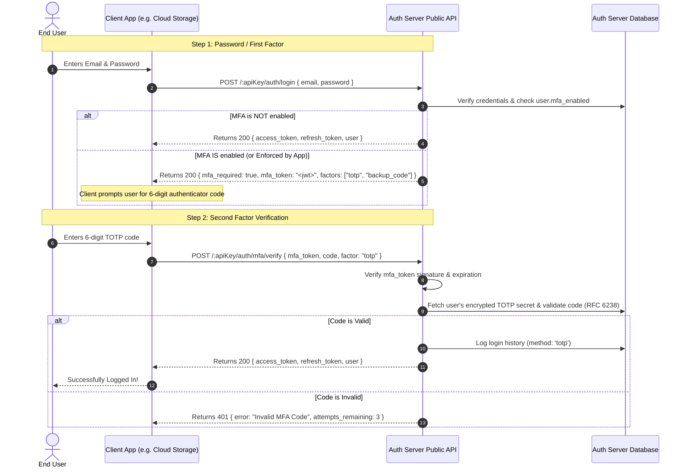

# Architectural Plan: Multi-Factor Authentication (MFA) as a Service in Auth Server

## 1. Overview & Objectives
Multi-Factor Authentication (MFA) adds a crucial second layer of security beyond passwords. By implementing MFA directly inside **Auth Server**, developers (and apps like Cloud Storage) can offer enterprise-grade authentication with zero external auth vendors.

### Core Objectives:
1. **Developer Control**: App developers can configure MFA policies in the Developer Cpanel (`Disabled`, `Optional`, or `Enforced`).
2. **Standard-Compliant TOTP**: Support Time-based One-Time Passwords (RFC 6238) compatible with Google Authenticator, Microsoft Authenticator, Apple Passwords, Authy, and 1Password.
3. **Email OTP & Recovery Codes**: Provide 6-digit email verification codes and hashed single-use backup recovery codes.
4. **Clean 2-Step Login API**: Backwards-compatible login flow that returns an `mfa_required` challenge without breaking existing non-MFA apps.
5. **Native SDK Support**: Simple helper methods in `@mspkapps/auth-client` for client applications.

---

## 2. How MFA Works: Step-by-Step Architecture



---

## 3. Database Schema Design

### 3.1 App Configuration (`dev_apps`)
Add MFA configuration columns to `dev_apps`:
```sql
ALTER TABLE dev_apps 
  ADD COLUMN IF NOT EXISTS mfa_policy VARCHAR(20) DEFAULT 'optional', -- 'disabled' | 'optional' | 'enforced'
  ADD COLUMN IF NOT EXISTS mfa_allowed_methods JSONB DEFAULT '["totp", "backup_code"]'::jsonb;
```

### 3.2 User MFA Factors (`user_mfa_factors` or `users` table)
To keep user records scalable and support multiple factors, a dedicated `user_mfa_factors` table is recommended:
```sql
CREATE TABLE IF NOT EXISTS user_mfa_factors (
  id UUID PRIMARY KEY DEFAULT uuid_generate_v4(),
  user_id UUID NOT NULL REFERENCES users(id) ON DELETE CASCADE,
  app_id UUID NOT NULL REFERENCES dev_apps(id) ON DELETE CASCADE,
  factor_type VARCHAR(30) NOT NULL, -- 'totp', 'email_otp'
  status VARCHAR(20) NOT NULL DEFAULT 'unverified', -- 'unverified', 'verified'
  secret_encrypted TEXT NOT NULL, -- AES-256 encrypted base32 TOTP secret
  backup_codes JSONB DEFAULT '[]'::jsonb, -- Array of hashed single-use recovery codes
  last_used_at TIMESTAMP(6),
  created_at TIMESTAMP(6) DEFAULT NOW(),
  updated_at TIMESTAMP(6) DEFAULT NOW(),
  CONSTRAINT uq_user_factor UNIQUE(user_id, factor_type)
);

CREATE INDEX IF NOT EXISTS idx_user_mfa_factors_user ON user_mfa_factors(user_id);
```
Additionally, add a quick flag on the `users` table:
```sql
ALTER TABLE users ADD COLUMN IF NOT EXISTS mfa_enabled BOOLEAN DEFAULT FALSE;
```

---

## 4. Endpoints & API Specifications

### 4.1 Authentication Flow (Public APIs)
| Method | Path | Auth Required | Description |
|---|---|---|---|
| `POST` | `/:apiKey/auth/login` | None | Validates password. If MFA is active, returns `{ mfa_required: true, mfa_token: "..." }` instead of tokens. |
| `POST` | `/:apiKey/auth/mfa/verify` | None (`mfa_token` in body) | Validates the TOTP code or backup code. Issues full `access_token` and `refresh_token`. |
| `POST` | `/:apiKey/auth/mfa/send-email-otp` | None (`mfa_token` in body) | Dispatches a 6-digit OTP to the user's verified email if email factor is selected. |

### 4.2 Factor Enrollment & Management (Authenticated APIs)
| Method | Path | Auth Required | Description |
|---|---|---|---|
| `POST` | `/:apiKey/user/mfa/totp/setup` | Bearer Token | Generates new secret, `otpauth://` URI, QR code base64 Data URL, and 8 backup codes. |
| `POST` | `/:apiKey/user/mfa/totp/confirm` | Bearer Token | Verifies code from the app. Marks `mfa_enabled = true` and activates the factor. |
| `POST` | `/:apiKey/user/mfa/backup-codes/regenerate` | Bearer Token | Generates a fresh set of recovery codes (requires current password or TOTP confirmation). |
| `POST` | `/:apiKey/user/mfa/disable` | Bearer Token | Disables MFA (requires password or TOTP verification). |
| `GET` | `/:apiKey/user/mfa/status` | Bearer Token | Returns user's active factors and configuration status. |

---

## 5. Security Architecture & Standards

1. **RFC 6238 Standard (TOTP)**:
   - Secret size: 160-bit (20 bytes) base32 encoded.
   - Hash algorithm: HMAC-SHA1 (universal standard for Google Authenticator/Authy).
   - Time step: 30 seconds.
   - Tolerance window: $\pm 1$ step (current, -30s, +30s) to absorb client/server clock drifts.
   - Replay protection: Store `last_verified_step` in cache/Redis or DB to reject re-used codes in the same 30s window.
2. **Encryption at Rest**:
   - The TOTP secret is never stored in plain text. It is encrypted using Auth Server's existing AES-256 (`passwordEncryptAES`) before writing to PostgreSQL.
3. **Ephemeral MFA Challenge Token**:
   - `mfa_token` is a short-lived JWT signed by `JWT_SECRET` with `type: 'mfa_challenge'`, expiring in **5 minutes**.
   - Contains only `{ userId, appId, email }`. It cannot be used as an API access token.
4. **Hashed Single-Use Recovery Codes**:
   - 8 random alphanumeric codes (e.g. `A7B2-9F1C`).
   - Plaintext codes are displayed to the user **only once** upon setup.
   - Database stores bcrypt or SHA-256 hashes of the codes. When used, the code is permanently deleted from the array.

---

## 6. Developer Experience & Cpanel Integration

### 6.1 In Cpanel / Developer Portal (`App Details` -> `App Settings`):
Add an **MFA Security Settings** card:
- **MFA Enforcement Policy**:
  - `Disabled`: MFA endpoints return disabled for this app.
  - `Optional (Recommended)`: Users can enable MFA in their app settings.
  - `Enforced`: Users must set up MFA to access the app.
- **Enabled Verification Methods**:
  - ☑ Authenticator Apps (TOTP)
  - ☑ Backup Recovery Codes
  - ☐ Email OTP (optional toggle)

### 6.2 In `@mspkapps/auth-client` SDK:
First-class methods available in `@mspkapps/auth-client` (v0.2.5+):

```javascript
// 1. In Login Flow
const res = await authClient.login({ email, password });

if (res.mfa_required) {
  // Show 2FA challenge input modal (TOTP or 8-char recovery code)
  const loginResult = await authClient.verifyMFA({
    mfa_token: res.mfa_token,
    code: userInputCode
  });
} else if (res.mfa_setup_required) {
  // App enforces MFA — mandatory onboarding required
  const setup = await authClient.setupMFAOnboarding({ mfa_token: res.mfa_token });
  // Display QR code: setup.data.qr_code
  // Confirm with user's first 6-digit code:
  const loginResult = await authClient.confirmMFAOnboarding({
    mfa_token: res.mfa_token,
    code: userInputCode
  });
  console.log(loginResult.data.backup_codes); // 8 emergency recovery codes
}

// 2. In User Profile Settings (Setup)
const setup = await authClient.setupMFA();
// Returns: { success: true, data: { qr_code: 'data:image/png;base64,...', secret: 'JBSWY3DPEHPK3PXP', otpauth_url: '...' } }

// 3. Confirm Setup & Activate
const confirmResult = await authClient.confirmMFA({ code: userInputCode });
console.log(confirmResult.data.backup_codes); // 8 single-use recovery codes

// 4. Check Status
const status = await authClient.getMFAStatus();
// Returns: { mfa_enabled: true, backup_codes_count: 8, allowed_methods: ['totp', 'backup_code'] }

// 5. Regenerate Backup Codes
const newCodes = await authClient.regenerateBackupCodes({ code: currentTotpCode });

// 6. Disable MFA
await authClient.disableMFA({ code: currentTotpCode });
```

---

## 7. Implementation Roadmap & Phases

### Phase 1: Database & Dependencies
- Install standard libraries in `Cpanel/auth-server`: `otplib` (RFC 6238 TOTP engine) and `qrcode` (QR generation).
- Run migration script on `authdb` for `dev_apps.mfa_policy` and `user_mfa_factors` table.

### Phase 2: Core MFA Engine & Public API Controller
- Implement `mfaService.js`:
  - `generateTotpSecret(appName, userEmail)`
  - `verifyTotpCode(secret, code)`
  - `generateBackupCodes()`
- Update `loginUser`:
  - If user has `mfa_enabled`, issue ephemeral `mfa_token` challenge.
- Implement endpoints:
  - `/:apiKey/auth/mfa/verify`
  - `/:apiKey/user/mfa/totp/setup`
  - `/:apiKey/user/mfa/totp/confirm`
  - `/:apiKey/user/mfa/disable`

### Phase 3: Developer Portal & Cpanel UI
- Add MFA policy controls to App Settings in Cpanel and Developer Portal.
- Display MFA status badge in the user details modal.

### Phase 4: SDK Updates & Client Adoption
- Update `@mspkapps/auth-client` with MFA helper methods.
- Demonstrate implementation in client application (e.g. Cloud Storage profile security settings and login screen).
